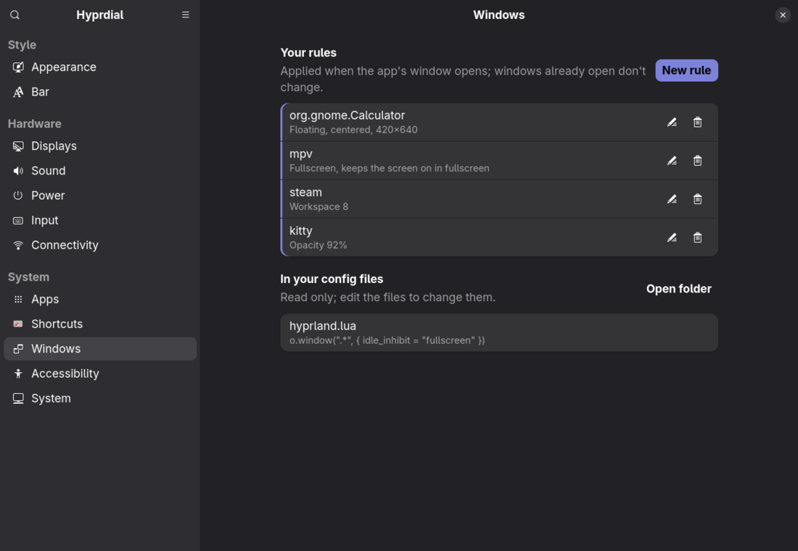
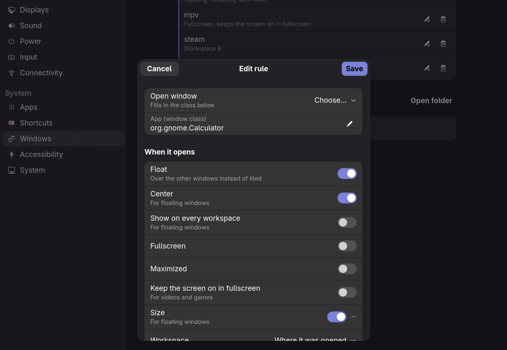
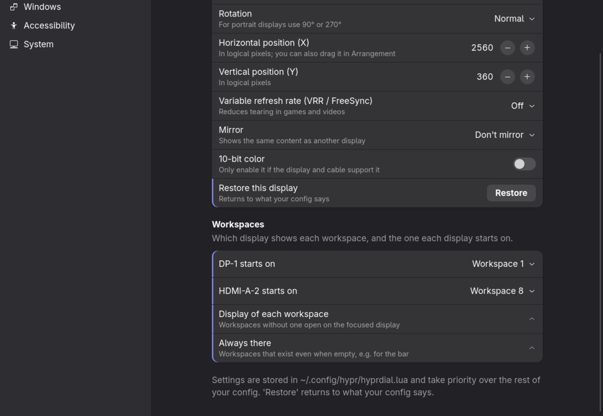
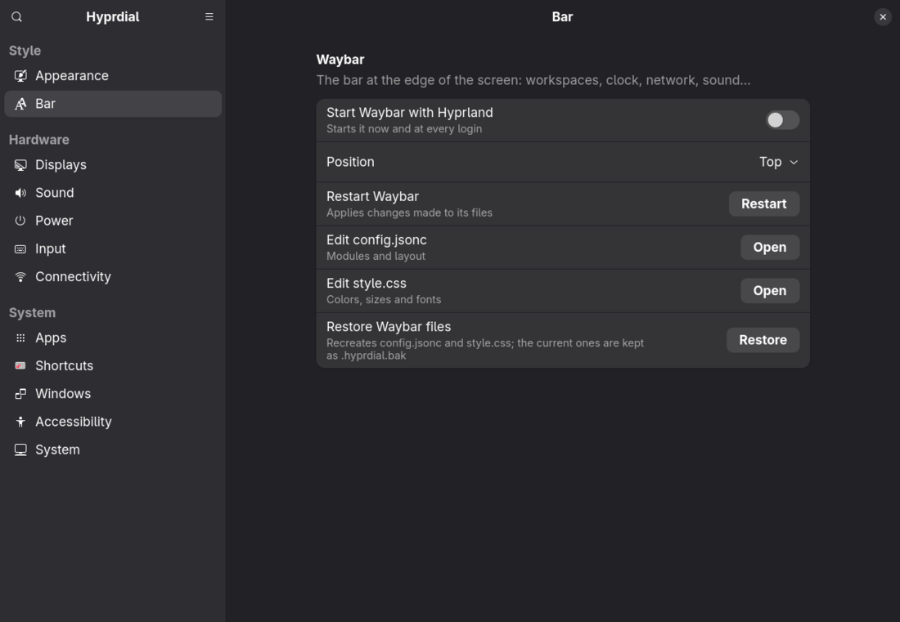

# Hyprdial

[](https://github.com/mvp-mark/hyprdial/actions/workflows/tests.yml)
[](https://github.com/mvp-mark/hyprdial/releases/latest)
[](LICENSE)

**A graphical settings app for [Hyprland](https://hypr.land).** Configure your displays, keyboard and mouse,
shortcuts, window look, sound, power, network, startup apps, language and more from windows, switches and sliders,
instead of editing `hyprland.lua` by hand. Built with GTK4 and libadwaita (Python), with extra pages when it runs
on [Omarchy](https://omarchy.org).


- **For any Hyprland 0.56 or newer** with the Lua configuration (`~/.config/hypr/hyprland.lua`). With an older
  Hyprland, or a config still in `hyprland.conf`, it opens with a notice and changes nothing in Hyprland.
- **Your config stays yours**: settings go to one generated file, `~/.config/hypr/hyprdial.lua`, loaded by a single
  `require` line in `hyprland.lua`. Your own files are never rewritten, and every change can be undone.
- **Changes apply live**, without restarting Hyprland; display changes revert by themselves unless you keep them.
- **On Omarchy** it also covers themes, the Omarchy shell bar, web apps, security setups and updates, through
  Omarchy's own commands (the screenshots here are from Omarchy).
- **Linux distributions**: Arch and derivatives, Fedora and openSUSE Tumbleweed; Debian and Ubuntu once they ship
  Hyprland 0.56. NixOS isn't supported: there the configuration is declared in Nix, not written by apps.

Hyprdial was called **omarchy-settings** before 1.0. Updating moves its files to the new names by itself (see
[How settings are stored](#how-settings-are-stored)), and the `omarchy-settings` command keeps working.

## Install

**Arch, Omarchy** (ready package from the [latest release](https://github.com/mvp-mark/hyprdial/releases/latest)):

```bash
sudo pacman -U https://github.com/mvp-mark/hyprdial/releases/download/v1.1.0/hyprdial-1.1.0-1-any.pkg.tar.zst
```

**Any supported distribution** (from the source, for your user only):

```bash
git clone https://github.com/mvp-mark/hyprdial
cd hyprdial && ./install.sh --deps   # installs what is missing with pacman, dnf or zypper, then the app
```

Then open **Hyprdial** from your app launcher, or run `hyprdial`. More options (RPM, building the package,
dependencies per distribution) are under [Installation details](#installation-details).

## Highlights

- **A sidebar of pages** grouped like Omarchy's menu: Style, Hardware and System. Twelve pages on any Hyprland,
  fourteen on Omarchy.
- **Window rules without regex**: pick an open window and choose what happens when it opens (float, size,
  workspace, opacity, fullscreen…). Workspaces get a display and a start workspace per display.
- **Shortcuts without editing Lua**: record a new key combination (keys, mouse buttons or the wheel), disable a
  shortcut or add your own to open an app or run a command, with warnings when keys are already taken.
- **Displays by drag and drop**: arrange monitors, pick resolution, refresh rate, scale and rotation.
- **Find anything** with **Ctrl+F**, and see what you changed from the defaults under **☰ → Changed
  settings**, each setting marked with a bar of the accent color.
- **Safe by design**: one generated file, backups before touching your files, Undo where it matters, passwords
  asked by the system in a visible terminal or a polkit prompt.
- **Follows your theme** on Omarchy: buttons and switches take the current theme's accent color.
- **Your language**: the interface follows the system language: English, Brazilian Portuguese, Spanish, French
  and German.


## Omarchy and plain Hyprland

| | Plain Hyprland | Omarchy |
|---|---|---|
| Pages | Appearance, Bar (Waybar), Displays, Sound, Power, Input, Connectivity, Apps, Shortcuts, Windows, Accessibility, System | the same, with Bar and fonts (the Omarchy shell bar) instead of Bar, plus Themes and Security |
| Shortcuts read from | every `.lua` file in `~/.config/hypr` (`hl.bind` calls) | Omarchy's binding files and your `bindings.lua` |
| Shortcuts and startup apps written with | Hyprland's Lua API (`hl.bind`, `hl.on("hyprland.start")`) | Omarchy's helpers (`o.bind`, `o.launch_on_start`), so they show in its menus |
| Window rules | `hl.window_rule` | `o.window` (Omarchy's wrapper) |
| Lock, idle and wallpaper | hypridle and hyprpaper, through the app's own `hyprdial-idle.conf` and `hyprdial-paper.conf` | the Omarchy shell and themes do it |
| Password prompts | your terminal (`xdg-terminal-exec`, kitty, foot, alacritty…) | Omarchy's floating terminal |
| Also on Omarchy only | | web apps, power button, Omarchy's idle times, hibernation, Omarchy updates and snapshots |

Hyprdial tells them apart by Omarchy's `omarchy` command and Lua helpers. `HYPRDIAL_PLATFORM=hyprland hyprdial`
shows the plain Hyprland version on an Omarchy machine.

### On plain Hyprland

| | |
|---|---|
|  **Windows**: rules for what happens when an app's window opens |  **New rule**: pick an open window, then what to do with it |
|  **Workspaces** on the Displays page: display and start workspace |  **Bar**: Waybar started with Hyprland, position and files |

## Pages

On a narrow window the sidebar and the page take turns, with a back button. Pages and options marked
*(Omarchy)* are shown only on Omarchy.

### Style

| | |
|---|---|
|  **Themes** *(Omarchy)*: gallery with previews and colors, wallpapers of the current theme |  **Appearance**: quick styles, gaps, borders, corners, opacity, blur, shadow |
|  **Bar and fonts** *(Omarchy)*: the Omarchy shell bar, its widgets and the system font | **Bar** *(plain Hyprland)*: Waybar started with Hyprland, its position and files. **Appearance** there also picks the wallpaper (hyprpaper) |

### Hardware

| | |
|---|---|
|  **Displays**: drag to arrange, resolution, refresh rate, scale, workspaces; brightness *(Omarchy)* |  **Sound**: devices, volume and the volume of each app |
|  **Power**: profile, night light, lock and idle; power button and hibernation *(Omarchy)* |  **Input**: keyboard layout and repeat, mouse, touchpad |

**Connectivity** (Ethernet, Wi-Fi and Bluetooth, with pairing) has no picture here: it would show network names
and addresses.

### System

| | |
|---|---|
|  **Apps**: default apps, startup apps, web apps *(Omarchy)* |  **Shortcuts**: change, disable or add shortcuts, with conflict warnings |
|  **Accessibility**: pointer size, animations; text size *(Omarchy)* |  **Security** *(Omarchy)*: fingerprint, FIDO2 key and SSH server |
|  **Windows**: window rules, yours and the ones in your config files | |
|  **System**: time, language, printers; notifications, updates and snapshots *(Omarchy)* |  **☰ → Changed settings**: everything that differs from the defaults |

Press **Ctrl+F** (or the search button) to find any setting by name on every page: accents and case don't
matter, and choosing a result opens its page, expands what is around it and highlights it.

<details>
<summary><b>What each page does, and how it applies changes</b></summary>

| Page | What it does | How it applies changes |
|---|---|---|
| Themes | Theme gallery with previews and color swatches, search and dark/light filter, current theme highlighted; all wallpapers of the current theme (yours included) with the one in use marked | `omarchy-theme-set`, `omarchy-theme-bg-set`, `omarchy-theme-bg-next` |
| Appearance | Quick styles (Compact, Default, Comfortable, Elegant); window layout, gaps, border, corners, opacity, dimming, blur, shadow; window and workspace behavior. A ↶ button per option returns it to its default. On plain Hyprland, the wallpaper: one image or one per display, and how it fits | `hyprctl eval` live + generated file; `hyprctl hyprpaper wallpaper` live + `~/.config/hypr/hyprdial-paper.conf`, started with `hyprpaper -c` |
| Displays | Drag-and-drop arrangement (snaps to edges); per display: enable/disable, resolution and refresh rate, scale, rotation, position, VRR, mirroring, 10-bit color, brightness (DDC/CI); workspaces: the display of workspaces 1–10, the one each display starts on, the ones that always exist | `hyprctl eval` live + generated file (asks for confirmation and reverts after 15 s), `omarchy-brightness-display`, `hl.workspace_rule` in the generated file |
| Sound | Output and input device (the default one), their volume and mute, volume above 100% (optional), a test sound; volume and mute of each app playing and of each app using the microphone; updates live; full mixer (wiremix) for profiles and moving an app to another device | `omarchy-audio-output-set-default` and `omarchy-audio-input-set-default` (they also move the apps playing or recording), `pactl` (PipeWire), `pactl subscribe` for live updates, `pw-play` |
| Power | Power profile (power saver, balanced, performance; only those the machine offers); night light on/off, warmth and a daily schedule; what the power button does (system menu, lock, suspend, shut down, nothing); screensaver, lock and "stay awake"; Suspend in the system menu on/off; hibernation set up or removed (in a terminal). On plain Hyprland: when to dim, lock, turn the screen off and suspend | `omarchy-powerprofiles-set` (remembered like the bar does), `hyprctl hyprsunset`, `~/.config/hypr/hyprsunset.conf` profiles (backup at `hyprsunset.conf.hyprdial.bak`), `XF86PowerOff` shortcut in the generated file, `idle` in `~/.config/omarchy/shell.json`, `omarchy-toggle-idle`; on plain Hyprland `~/.config/hypr/hyprdial-idle.conf`, started with `hypridle -c`, `omarchy-toggle suspend-off`, `omarchy-hibernation-setup`/`-remove` |
| Input | Touchpad and touchscreen on/off (when the computer has them); keyboard layout and key repeat; mouse speed, acceleration, scrolling, focus and pointer; touchpad gestures and scrolling (with a touchpad) | `omarchy-toggle-input-device`, `hyprctl eval` live + generated file |
| Shortcuts | Every active shortcut, by category, searchable by name or key; change the key of a shortcut from Omarchy's or your config files (by recording the combination: keys, mouse buttons or the wheel, with a modifier; moving and resizing windows stay on a mouse button), including the ones Omarchy generates in loops (workspaces 1–10, group windows, bar panels), disable it, restore it with ↶; your own shortcuts to open apps, run commands or open in the terminal; conflict warnings | `hyprctl binds` + parsing `o.bind`/`hl.bind` calls: Omarchy's `default/hypr/bindings/*.lua` and your `bindings.lua`, or every `.lua` file in `~/.config/hypr` on plain Hyprland (numeric `for` loops unrolled); `hl.unbind` and `o.bind` (Omarchy) or `hl.bind` in the generated file, with reload and verification |
| Windows | Your rules for what happens when an app's window opens: float, center, size, workspace (in the background or not), opacity, every workspace, fullscreen, maximized, keep the screen on in fullscreen; chosen from the open windows or a typed class; the rules in your `.lua` files, read only | `hyprctl clients`, `hl.window_rule` (`o.window` on Omarchy) in the generated file |
| Apps | Default apps: browser, terminal and editor, file manager, PDF documents and images (installed ones only); web apps: list, add (the site's own icon by default) and remove; startup apps: XDG autostart entries on/off, your own commands, the commands in `autostart.lua` on Omarchy or `hyprland.lua` elsewhere (read only) | `omarchy default` (the browser goes through `xdg-mime` on plain Hyprland), `xdg-mime` (`~/.config/mimeapps.list`), `omarchy-webapp-install`, `omarchy-webapp-remove`, `Hidden=true` overrides in `~/.config/autostart`, `o.launch_on_start` (Omarchy) or `hl.on("hyprland.start")` in the generated file |
| Bar and fonts | Omarchy shell bar: show/hide, position, transparency, clock format; widgets per section (reorder, move between sections, remove, add; spacers can repeat, and each one is removed on its own); optional Waybar (see below); system font | `omarchy-bar`, `omarchy-plugin-enable/disable`, the layout in `~/.config/omarchy/shell.json` for a single spacer, `omarchy-toggle-bar`, `omarchy-font-set` |
| Bar (plain Hyprland) | Waybar on/off with Hyprland, position, restart, edit or restore its files (neutral starter files, nothing of Omarchy's) | `waybar`, `~/.config/waybar/config.jsonc` and `style.css`, `hl.on("hyprland.start")` in the generated file |
| Connectivity | Wired (Ethernet): status, link speed, address, gateway and DNS, plain-language diagnosis (no cable, 10 Mb/s link, no DHCP address), connect/disconnect, IPv4 automatic (DHCP) or manual, custom DNS, auto-connect; Wi-Fi: radio on/off, available networks with signal and security, connect (password asked in a dialog, hidden networks too), saved networks with IPv4/DNS settings and forget, impala for advanced cases; Bluetooth: on/off, paired devices with battery level, connect/disconnect, forget, search and pair (pairing codes shown or confirmed in a dialog), bluetui for advanced cases | `nmcli` (NetworkManager), libnm for saving Wi-Fi passwords (never on a command line), `/sys/class/net`, `omarchy-bluetooth-power` and `omarchy-bluetooth-device` (results read back with `bluetoothctl`), `bluetoothctl` for pairing through an interactive session with a KeyboardDisplay agent |
| Accessibility | Text size; pointer size (GTK apps, Hyprland and apps started later); animations on/off | `omarchy-display-text-size`, `gsettings` and `hyprctl setcursor` live + `XCURSOR_SIZE`/`HYPRCURSOR_SIZE` in the generated file, `hyprctl eval` |
| Security | Fingerprint (with a reader), security key (FIDO2) and SSH server: set up, set up again or remove, with the same conditions as Omarchy's Setup and Remove menus; whether the SSH server is running | `omarchy-setup-security-*` and `omarchy-remove-security-*` in a floating terminal |
| System | Time zone (searchable) and automatic time (NTP); system language, and installing another one (in a terminal: from `/etc/locale.gen` with `locale-gen` on Arch and Debian, a `glibc-langpack` on Fedora; suggested from the keyboard layout, and applied when it finishes with "Install and use"); notifications: do not disturb and recent notifications; printers (opens the CUPS web interface); about this computer (this app's version and how it was installed, with a warning when it is installed twice and a note when a newer release is out; Omarchy version, kernel, processor, memory), whether an Omarchy update is available, "Update Omarchy", "Create a snapshot now" (restored from the boot menu) | `timedatectl`, `localectl` (both ask for the password through polkit), `omarchy-shell notifications`, CUPS at `localhost:631`, `omarchy-update-available`, `omarchy-update`, `omarchy-snapshot create` and `sudo locale-gen` in a floating terminal |

</details>

## How settings are stored

Neither your files nor Omarchy's are modified. Hyprland, display, shortcut, power button, startup command and
pointer size settings go to `~/.config/hypr/hyprdial.lua`, and **a single line** `require("hypr.hyprdial")` is
inserted into `~/.config/hypr/hyprland.lua` (backup at `hyprland.lua.hyprdial.bak`): right before Omarchy's
toggles on Omarchy, at the end elsewhere, so these values take priority over the rest of your config. The app's
own state lives in `~/.config/hyprdial/state.json`. Each page restores only its own
settings: "Restore defaults" on the Hyprland page, "Restore this display" and "Restore all shortcuts".
**☰ → Restore app defaults** empties the generated file at once (a copy is kept as
`hyprdial.lua.<date>.bak`, and the toast offers Undo). Shortcuts
are wrapped in `pcall`, so a broken shortcut can't take down the rest of the file.
The bar is changed through Omarchy's own commands, which talk to the running shell.

From omarchy-settings (before 1.0), the first start moves `~/.config/hypr/omarchy-settings.lua` to `hyprdial.lua`,
`~/.config/omarchy-settings/` to `~/.config/hyprdial/`, and changes the `require` line to match; the new file is in
place before the line changes, so Hyprland never loads a missing file.

## Waybar on Omarchy (optional)

Omarchy now uses the Omarchy shell bar and no longer manages Waybar. The **Bar and fonts** page can still run
Waybar instead of it:

- **Use Waybar instead of the Omarchy bar** starts Waybar, hides the Omarchy bar and starts Waybar at login (an
  Omarchy `post-boot` hook). Turning it off stops Waybar and shows the Omarchy bar again.
- A starter `~/.config/waybar/config.jsonc` and `style.css` are created if they don't exist (existing files are
  never overwritten; "Restore Waybar files" recreates them and keeps the old ones as `.hyprdial.bak`).
- Colors follow the Omarchy theme: a user template (`~/.config/omarchy/themed/waybar.css.tpl`) is rendered by Omarchy
  on every theme change, `style.css` imports it, and a `theme-set` hook reloads Waybar.
- Position, restart and shortcuts to edit both files.

## Installation details

### From the source (`install.sh`)

Installs for your user only (`~/.local/share/hyprdial`, `~/.local/bin/hyprdial`, the launcher entry), no pip:

```bash
./install.sh --deps   # installs missing dependencies (asks for your sudo password), then the app
hyprdial
```

| Option | What it does |
|---|---|
| `./install.sh` | Installs the app only (fails with a hint if a required dependency is missing) |
| `./install.sh --deps` | Installs missing required and optional dependencies first (except Waybar) |
| `./install.sh --dev` | Same as `--deps`, plus development tools (pytest) |
| `./install.sh --waybar` | Also installs Waybar; can be combined with the options above |

Dependencies, listed in `hyprdial/deps.py`:

| Group | Arch | Fedora | openSUSE | Debian |
|---|---|---|---|---|
| Required | `python-gobject`, `gtk4`, `libadwaita` (>= 1.5), `gettext` | `python3-gobject`, `gtk4`, `libadwaita`, `gettext` | `python3-gobject`, `typelib-1_0-Gtk-4_0`, `typelib-1_0-Adw-1`, `gettext-tools` | `python3-gi`, `gir1.2-gtk-4.0`, `gir1.2-adw-1`, `gettext` |
| Optional | `libnm`, `impala`, `bluetui`, `wiremix`, `waybar` | `NetworkManager-libnm`, `waybar` | `typelib-1_0-NM-1_0`, `waybar` | `gir1.2-nm-1.0`, `waybar` |
| Optional, plain Hyprland | `hypridle`, `hyprlock`, `hyprpaper`, `brightnessctl` | `brightnessctl` (the others only from third-party repositories) | the same as Arch | the same as Arch |
| Development | `python-pytest` | `python3-pytest` | `python3-pytest` | `python3-pytest` |

`libnm` saves Wi-Fi passwords (it comes with NetworkManager); `impala`, `bluetui` and `wiremix` are TUIs opened by
the Connectivity and Sound pages, packaged on Arch only. CI installs these names on Fedora, openSUSE Tumbleweed
and Debian to make sure they exist. Waybar is offered on Omarchy as an optional alternative bar only: Omarchy uses
the Omarchy shell bar, and installing Waybar doesn't start it or replace the current bar.

Dependencies can also be installed from inside the app: **☰ → Dependencies** shows what's installed and installs
the selected packages with the system's package manager (`pacman`, `dnf`, `zypper` or `apt-get`), asking for your
password through polkit. On another system it only shows what is missing.

To try it without installing: `python3 -m hyprdial` from the project folder.

An `./install.sh` copy can live next to a package: the one in `~/.local/bin` comes first in `PATH`, so remove it
(`rm -r ~/.local/share/hyprdial ~/.local/bin/hyprdial ~/.local/bin/omarchy-settings`) to use the package; the
System page warns when both are installed.

### As a pacman package (Arch, Omarchy)

Each [release](https://github.com/mvp-mark/hyprdial/releases) carries a ready package (`arch=any`, so it fits every
machine). It installs system-wide, with the app in `/usr/share/hyprdial`, the `hyprdial` command (and
`omarchy-settings`, its old name) and the launcher entry, and replaces `omarchy-settings-gui`, the package's name
before 1.0:

```bash
sudo pacman -U https://github.com/mvp-mark/hyprdial/releases/download/v1.1.0/hyprdial-1.1.0-1-any.pkg.tar.zst
```

Or build it yourself from `packaging/arch/PKGBUILD`, which takes the release tag's source and compiles the
translations:

```bash
git clone https://github.com/mvp-mark/hyprdial
cd hyprdial/packaging/arch && makepkg -si
```

> **Packages from releases 0.5.0 to 0.5.2 were named `omarchy-settings` and replace Omarchy's own package of that
> name** (Omarchy's defaults, fonts and helpers). They have been taken down; if you installed one, put Omarchy's back
> with `sudo pacman -S omarchy-settings` and install `hyprdial` instead.

Publishing it on the AUR is described in [packaging/arch/README.md](packaging/arch/README.md).

### As an RPM (Fedora, openSUSE)

There is no published RPM repository yet. `packaging/rpm/hyprdial.spec` builds a `noarch` RPM with each family's
dependencies (CI builds and installs it on Fedora and openSUSE Tumbleweed); how to build it and to publish it on
COPR and OBS is in [packaging/rpm/README.md](packaging/rpm/README.md).

## Language

The interface follows the system language (`LANGUAGE`, `LC_ALL`, `LC_MESSAGES`, `LANG`). Source strings are in
English, which is also the fallback when there is no translation. Included translations: Brazilian Portuguese
(`po/pt_BR.po`, also used for other Portuguese variants), Spanish (`po/es.po`), French (`po/fr.po`) and German
(`po/de.po`). The Spanish, French and German ones are new and have not been reviewed by native speakers yet;
corrections are welcome. Dates follow the system's regional format (`LC_TIME`). To try another language without
changing the system: `LANGUAGE=de hyprdial`.

`install.sh` compiles the catalogs with `msgfmt` (`gettext` package). To update or add a language:

```bash
xgettext --language=Python --keyword=_ --keyword=ngettext:1,2 --from-code=UTF-8 \
  -o po/hyprdial.pot $(find hyprdial -name '*.py')
for po in po/*.po; do msgmerge -U "$po" po/hyprdial.pot; done  # update the translations
msginit -i po/hyprdial.pot -l it -o po/it.po                       # or add a language
./install.sh
```

Omarchy's shortcut names are shown as Omarchy itself writes them (in English).

## Tests

```bash
./install.sh --dev    # or install pytest with your package manager
python3 -m pytest
```

They cover the non-UI parts (`core.py`, `host.py`, `distro.py`, `windowrules.py`, `workspaces.py`, `idle.py`, `wallpaper.py`, `layout.py`, `keybinds.py`, `deps.py`, `themes_data.py`, `waybar.py`, `shell.py`, `displays.py`, `accessibility.py`, `input.py`, `security.py`, `network.py`, `wifi.py`, `bluetooth.py`, `apps.py`, `webapps.py`, `autostart.py`, `sound.py`, `power.py`, `system.py`, `search.py`) and that the PKGBUILD's dependencies match `deps.py`, without touching the running Hyprland, and
the translations: every marked string has a translation, no translation is left unused, and the placeholders
(`{name}`…) match between English and the translation.
`tests/fixtures/` holds trimmed copies of Omarchy's shortcut files; an extra test reads the real files (skipped if
Omarchy isn't installed) and fails if an update changes their format.
`tests/test_pages_smoke.py` opens the window on a headless Broadway display (`gtk4-broadwayd`, part of `gtk4`) with
an empty home folder and fake commands, shows every page on Omarchy and on plain Hyprland, twice each (no command
installed; every command answering nothing), and fails on any Python error raised inside GTK; it is skipped when
Broadway or libadwaita is missing. The unit tests run as on Omarchy (`HYPRDIAL_PLATFORM` and the `plain_hyprland`
fixture switch to plain Hyprland). CI runs everything on Arch, and the tests plus the dependency names on Fedora,
openSUSE Tumbleweed and Debian.

## Layout

The layers and the rules new code follows are in [docs/ARCHITECTURE.md](docs/ARCHITECTURE.md).

```
hyprdial/
  core.py            running commands and editing the configs (no GTK, testable)
  host.py            Omarchy or plain Hyprland, the Hyprland version, commands that differ between them (no GTK)
  distro.py          the distribution family and its package manager (no GTK)
  deps.py            dependency list and check (no GTK; also used by install.sh)
  themes_data.py     themes, previews, colors and wallpapers (no GTK)
  waybar.py          optional Waybar: starter files, theme colors, hooks, start/stop (no GTK)
  keybinds.py        shortcuts: parsing the Lua sources, matching and generation (no GTK)
  input.py           touchpad and touchscreen on/off (no GTK)
  layout.py          display arrangement geometry: snapping and overlap (no GTK)
  network.py         wired connections through nmcli: state, profiles, validation, commands (no GTK)
  wifi.py            Wi-Fi through nmcli: radio, scan, saved networks, commands (no GTK)
  nm.py              saving a Wi-Fi password through libnm, never on a command line
  bluetooth.py       Bluetooth through bluetoothctl: devices, scan, commands, pairing output parser (no GTK)
  sound.py           output/input devices and app streams through pactl (no GTK)
  security.py        fingerprint, FIDO2 and SSH server setups, as Omarchy's menu offers them (no GTK)
  shell.py           Omarchy shell: bar, widgets, idle, font (no GTK)
  accessibility.py   pointer size (no GTK)
  displays.py        display brightness and text size (no GTK)
  power.py           power profile, night light and its schedule, power button (no GTK)
  idle.py            lock and idle on plain Hyprland through hypridle (no GTK)
  wallpaper.py       wallpaper on plain Hyprland through hyprpaper (no GTK)
  windowrules.py     window rules: open windows, validation, generation, the user's rules (no GTK)
  workspaces.py      workspace rules: display, start workspace, always there (no GTK)
  apps.py            default apps: Omarchy's and by file type (no GTK)
  autostart.py       startup apps: XDG autostart entries and own commands (no GTK)
  webapps.py         web apps: listing the launchers, checking the form, install/remove (no GTK)
  system.py          date and time, language, notifications, system info (no GTK)
  search.py          settings search: accent-insensitive matching and ranking (no GTK)
  i18n.py            translation (gettext) in the system language
  ui.py              widget helpers
  app.py             main window
  pages/             one module per page (hyprland.py holds Appearance and Input), plus the groups they share
                     (ethernet, wifi, bluetooth, webapps, autostart), the search dialog and dependencies
data/                .desktop
packaging/arch/      PKGBUILD, .SRCINFO, the release build and the AUR publishing script
packaging/rpm/       RPM spec for Fedora and openSUSE (COPR, OBS)
docs/releases/       release notes, one file per tag (the release workflow publishes them)
docs/screenshots/    images used by this README
po/                  template (.pot) and translations (.po)
tests/               pytest + fixtures
install.sh
pyproject.toml       ruff and pytest settings
```

## Next steps

- The package on the AUR, COPR and OBS: everything is ready in `packaging/` (see the READMEs there); each needs
  the maintainer's account.
- Native speakers' review of the Spanish, French and German translations, and more languages.

## License

[MIT](LICENSE).
