# omarchy-settings

[](https://github.com/mvp-mark/omarchy-settings/actions/workflows/tests.yml)
[](LICENSE)

A graphical settings app for [Omarchy](https://omarchy.org), built with GTK4 + libadwaita (Python). It changes
your system through Omarchy's own commands and never edits what Omarchy ships, so updates keep working and every
change can be undone.

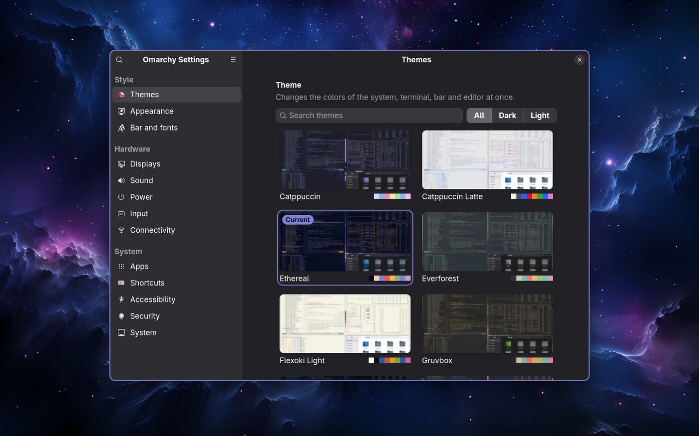

**Requires Omarchy with the Lua-based Hyprland configuration** (`~/.config/hypr/hyprland.lua`, Hyprland 0.5x)
and the Omarchy shell. Older installs that use `hyprland.conf` and Waybar are not supported.

## Highlights

- **Thirteen pages in a sidebar** grouped like Omarchy's menu: Style, Hardware and System.
- **Follows your theme**: buttons and switches take the current Omarchy theme's accent color, and change with it.
- **Live changes**: Hyprland options, displays, sound and the night light apply at once; display changes revert
  by themselves unless you keep them.
- **Find anything** with **Ctrl+F**, and see what you changed from Omarchy's defaults under **☰ → Changed
  settings**, each setting marked with a bar of the accent color.
- **Safe by design**: one generated file for Hyprland settings, backups before touching your files, Undo where it
  matters, passwords asked by the system in a visible terminal or a polkit prompt.
- **Your language**: the interface follows the system language (English and Brazilian Portuguese included).

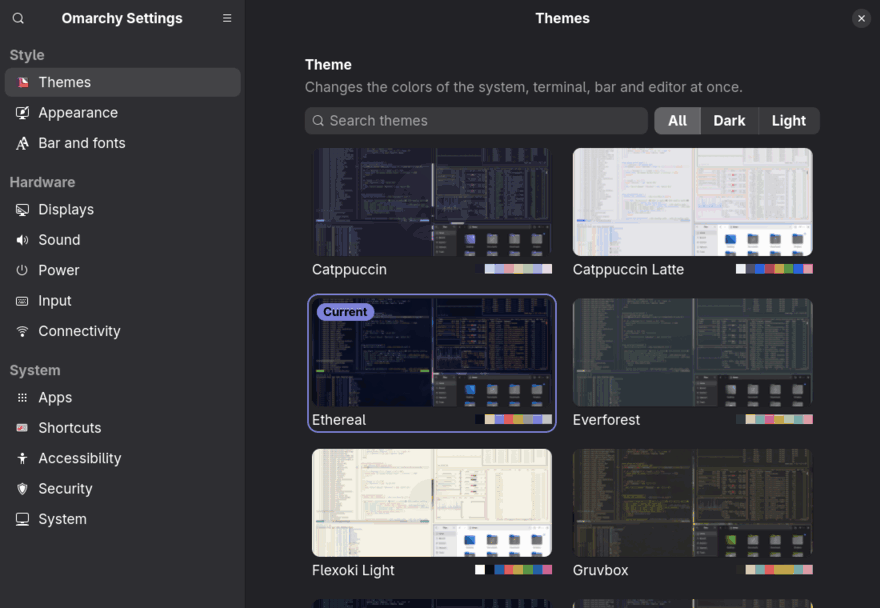

## Pages

The pages sit in a sidebar grouped like Omarchy's menu. On a narrow window the sidebar and the page take turns,
with a back button.

### Style

| | |
|---|---|
| 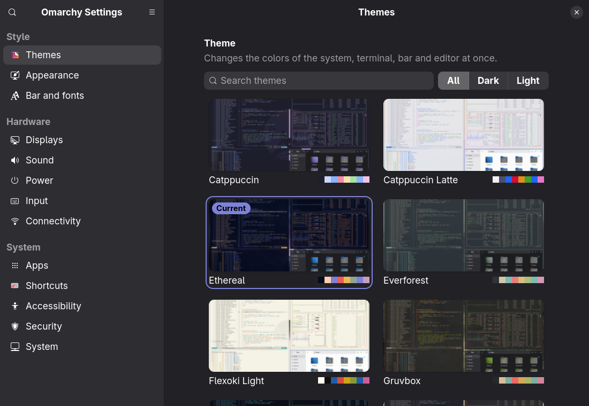 **Themes**: gallery with previews and colors, wallpapers of the current theme | 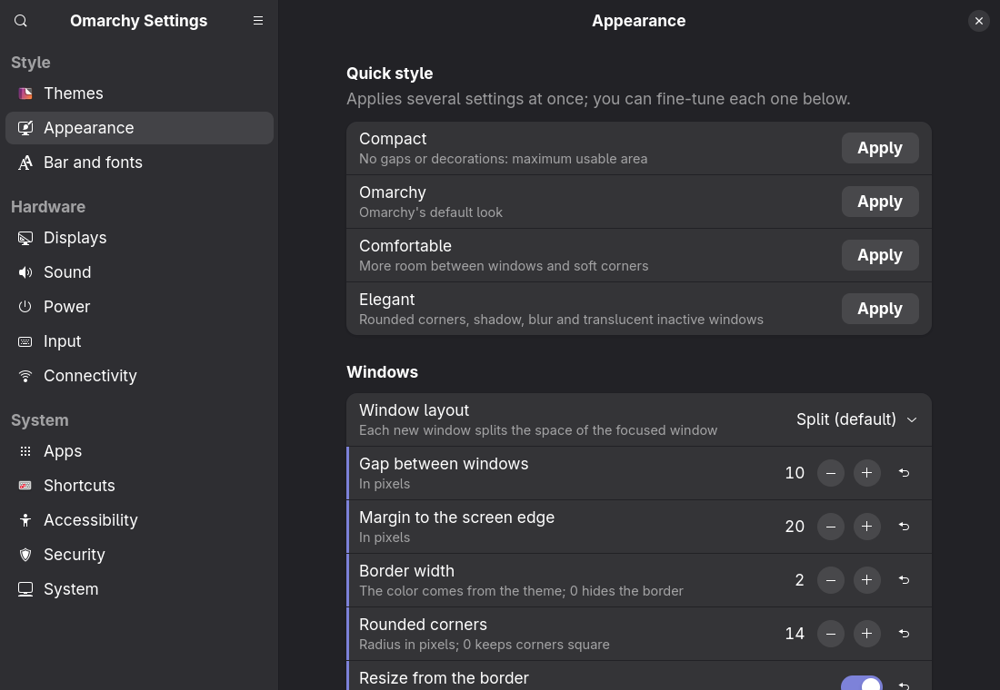 **Appearance**: quick styles, gaps, borders, corners, opacity, blur, shadow |
| 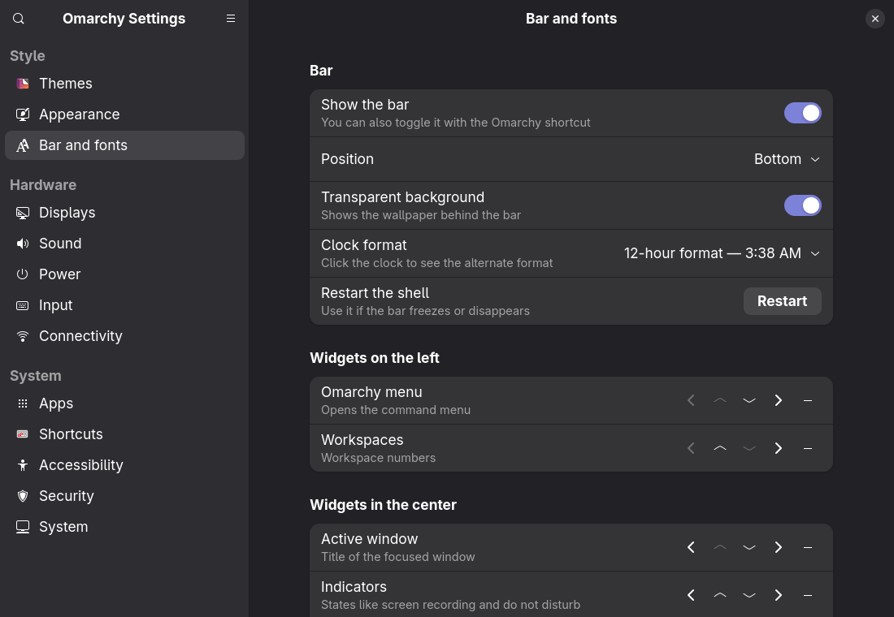 **Bar and fonts**: the Omarchy shell bar, its widgets and the system font | |

### Hardware

| | |
|---|---|
| 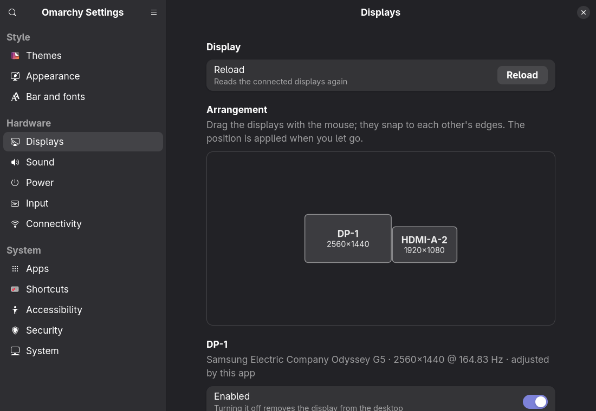 **Displays**: drag to arrange, resolution, refresh rate, scale, brightness | 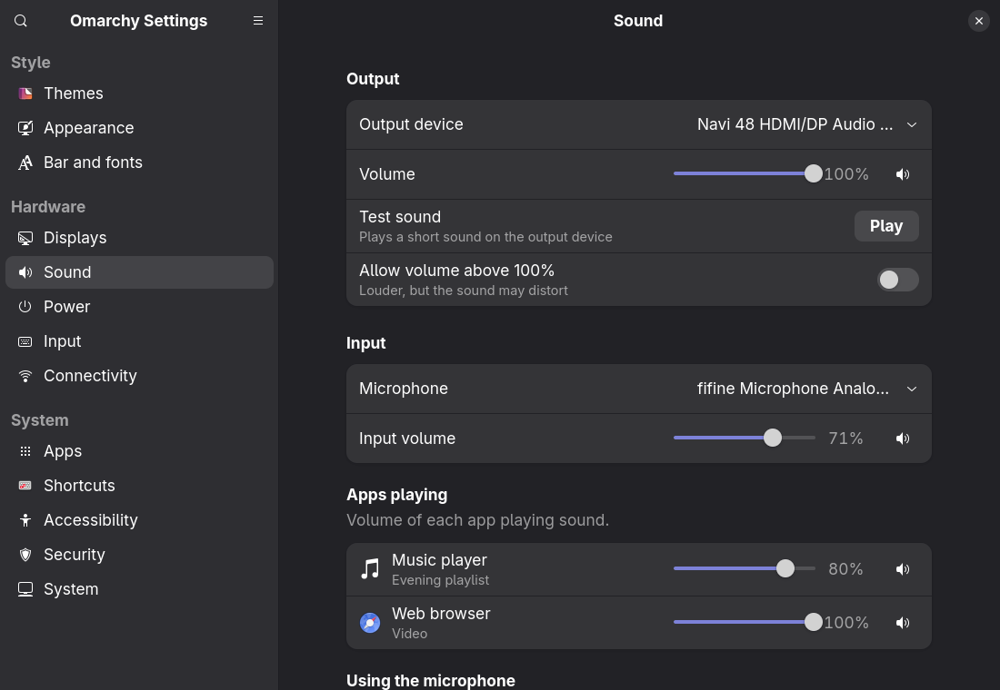 **Sound**: devices, volume and the volume of each app |
| 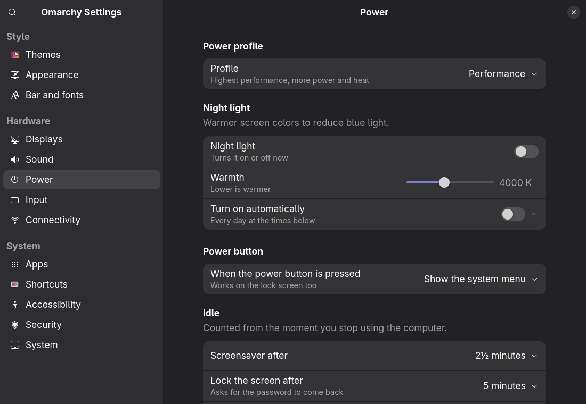 **Power**: profile, night light, power button, idle, suspend and hibernation | 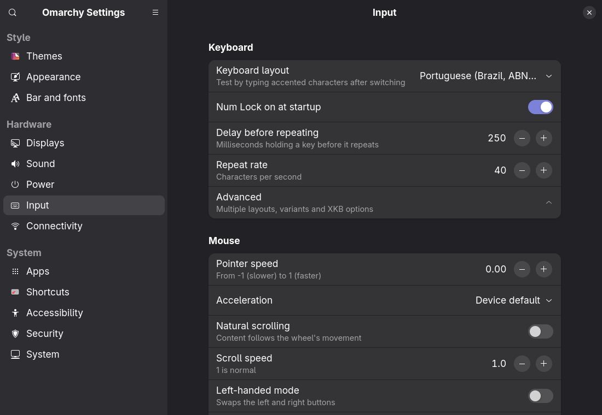 **Input**: keyboard layout and repeat, mouse, touchpad |

**Connectivity** (Ethernet, Wi-Fi and Bluetooth, with pairing) has no picture here: it would show network names
and addresses.

### System

| | |
|---|---|
| 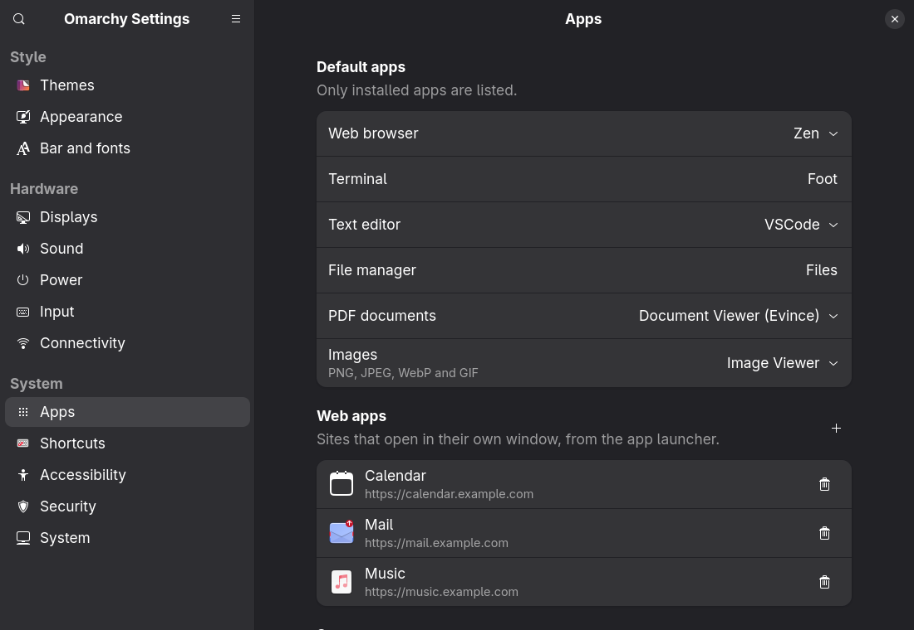 **Apps**: default apps, web apps and startup apps | 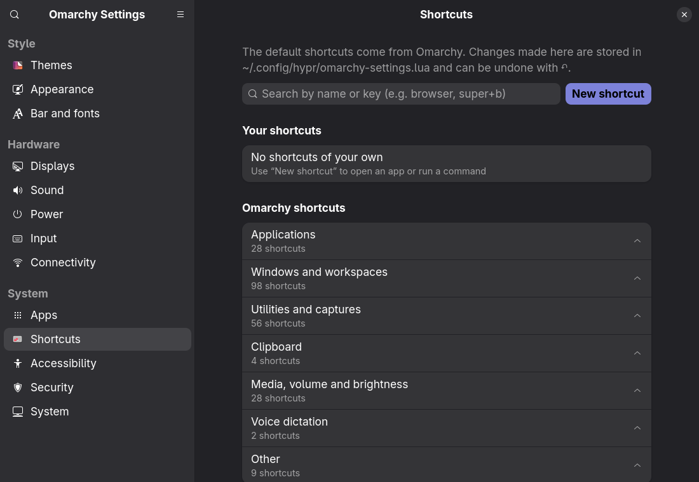 **Shortcuts**: change, disable or add shortcuts, with conflict warnings |
| 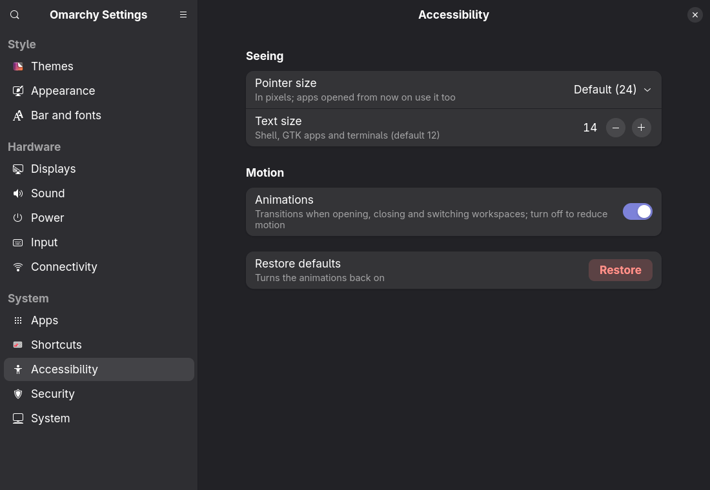 **Accessibility**: text size, pointer size, animations | 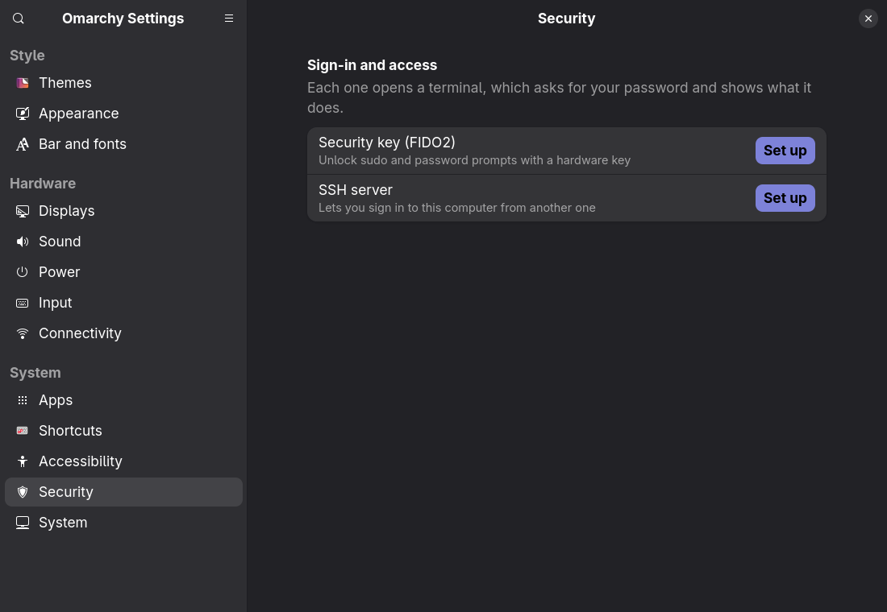 **Security**: fingerprint, FIDO2 key and SSH server |
| 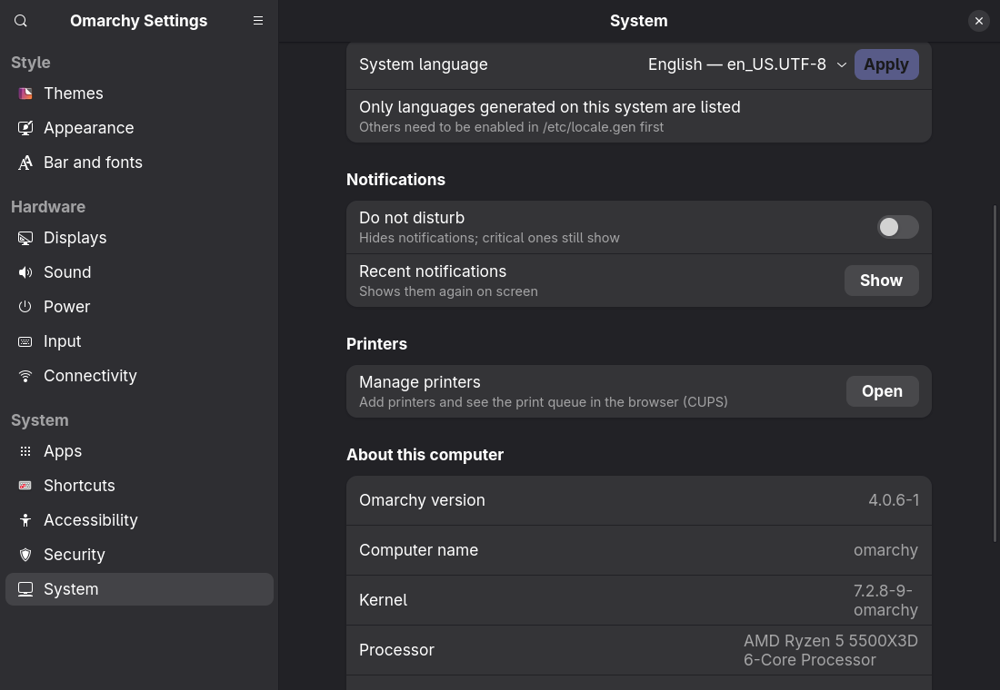 **System**: time, language, notifications, printers, updates and snapshots | 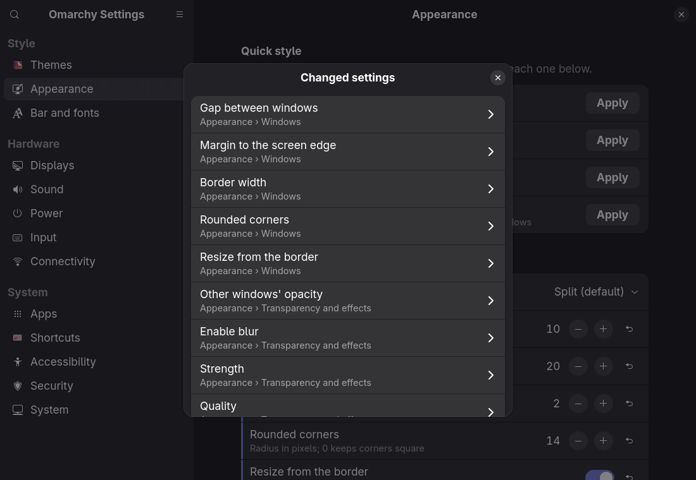 **☰ → Changed settings**: everything that differs from Omarchy's defaults |

Press **Ctrl+F** (or the search button) to find any setting by name on every page: accents and case don't
matter, and choosing a result opens its page, expands what is around it and highlights it.

<details>
<summary><b>What each page does, and how it applies changes</b></summary>

| Page | What it does | How it applies changes |
|---|---|---|
| Themes | Theme gallery with previews and color swatches, search and dark/light filter, current theme highlighted; all wallpapers of the current theme (yours included) with the one in use marked | `omarchy-theme-set`, `omarchy-theme-bg-set`, `omarchy-theme-bg-next` |
| Appearance | Quick styles (Compact, Omarchy, Comfortable, Elegant); window layout, gaps, border, corners, opacity, dimming, blur, shadow; window and workspace behavior. A ↶ button per option returns it to Omarchy's default | `hyprctl eval` live + generated file |
| Displays | Drag-and-drop arrangement (snaps to edges); per display: enable/disable, resolution and refresh rate, scale, rotation, position, VRR, mirroring, 10-bit color, brightness (DDC/CI) | `hyprctl eval` live + generated file (asks for confirmation and reverts after 15 s), `omarchy-brightness-display` |
| Sound | Output and input device (the default one), their volume and mute, volume above 100% (optional), a test sound; volume and mute of each app playing and of each app using the microphone; updates live; full mixer (wiremix) for profiles and moving an app to another device | `omarchy-audio-output-set-default` and `omarchy-audio-input-set-default` (they also move the apps playing or recording), `pactl` (PipeWire), `pactl subscribe` for live updates, `pw-play` |
| Power | Power profile (power saver, balanced, performance; only those the machine offers); night light on/off, warmth and a daily schedule; what the power button does (system menu, lock, suspend, shut down, nothing); screensaver, lock and "stay awake"; Suspend in the system menu on/off; hibernation set up or removed (in a terminal) | `omarchy-powerprofiles-set` (remembered like the bar does), `hyprctl hyprsunset`, `~/.config/hypr/hyprsunset.conf` profiles (backup at `hyprsunset.conf.omarchy-settings.bak`), `XF86PowerOff` shortcut in the generated file, `idle` in `~/.config/omarchy/shell.json`, `omarchy-toggle-idle`, `omarchy-toggle suspend-off`, `omarchy-hibernation-setup`/`-remove` |
| Input | Touchpad and touchscreen on/off (when the computer has them); keyboard layout and key repeat; mouse speed, acceleration, scrolling, focus and pointer; touchpad gestures and scrolling (with a touchpad) | `omarchy-toggle-input-device`, `hyprctl eval` live + generated file |
| Shortcuts | Every active shortcut, by category, searchable by name or key; change the key of an Omarchy shortcut (by recording the combination), disable it, restore it with ↶; your own shortcuts to open apps, run commands or open in the terminal; conflict warnings | `hyprctl binds` + parsing `default/hypr/bindings/*.lua`; `hl.unbind`/`o.bind` in the generated file, with reload and verification |
| Apps | Default apps: browser, terminal and editor, file manager, PDF documents and images (installed ones only); web apps: list, add (the site's own icon by default) and remove; startup apps: XDG autostart entries on/off, your own commands, the commands in `autostart.lua` (read only) | `omarchy default`, `xdg-mime` (`~/.config/mimeapps.list`), `omarchy-webapp-install`, `omarchy-webapp-remove`, `Hidden=true` overrides in `~/.config/autostart`, `o.launch_on_start` in the generated file |
| Bar and fonts | Omarchy shell bar: show/hide, position, transparency, clock format; widgets per section (reorder, move between sections, remove, add); optional Waybar (see below); system font | `omarchy-bar`, `omarchy-plugin-enable/disable`, `omarchy-toggle-bar`, `omarchy-font-set` |
| Connectivity | Wired (Ethernet): status, link speed, address, gateway and DNS, plain-language diagnosis (no cable, 10 Mb/s link, no DHCP address), connect/disconnect, IPv4 automatic (DHCP) or manual, custom DNS, auto-connect; Wi-Fi: radio on/off, available networks with signal and security, connect (password asked in a dialog, hidden networks too), saved networks with IPv4/DNS settings and forget, impala for advanced cases; Bluetooth: on/off, paired devices with battery level, connect/disconnect, forget, search and pair (pairing codes shown or confirmed in a dialog), bluetui for advanced cases | `nmcli` (NetworkManager), libnm for saving Wi-Fi passwords (never on a command line), `/sys/class/net`, `omarchy-bluetooth-power` and `omarchy-bluetooth-device` (results read back with `bluetoothctl`), `bluetoothctl` for pairing through an interactive session with a KeyboardDisplay agent |
| Accessibility | Text size; pointer size (GTK apps, Hyprland and apps started later); animations on/off | `omarchy-display-text-size`, `gsettings` and `hyprctl setcursor` live + `XCURSOR_SIZE`/`HYPRCURSOR_SIZE` in the generated file, `hyprctl eval` |
| Security | Fingerprint (with a reader), security key (FIDO2) and SSH server: set up, set up again or remove, with the same conditions as Omarchy's Setup and Remove menus; whether the SSH server is running | `omarchy-setup-security-*` and `omarchy-remove-security-*` in a floating terminal |
| System | Time zone (searchable) and automatic time (NTP); system language (among those generated); notifications: do not disturb and recent notifications; printers (opens the CUPS web interface); about this computer (Omarchy version, kernel, processor, memory), whether an Omarchy update is available, "Update Omarchy", "Create a snapshot now" (restored from the boot menu) | `timedatectl`, `localectl` (both ask for the password through polkit), `omarchy-shell notifications`, CUPS at `localhost:631`, `omarchy-update-available`, `omarchy-update` and `omarchy-snapshot create` in a floating terminal |

</details>

## How settings are stored

Nothing managed by Omarchy is modified. Hyprland, display, shortcut, power button, startup command and pointer size settings go to
`~/.config/hypr/omarchy-settings.lua`, and **a single line** `require("hypr.omarchy-settings")` is inserted into
`~/.config/hypr/hyprland.lua` right before Omarchy's toggles (backup at `hyprland.lua.omarchy-settings.bak`), so
these values take priority over `monitors.lua`, `input.lua` and `looknfeel.lua`. Each page restores only its own
settings: "Restore defaults" on the Hyprland page, "Restore this display" and "Restore all shortcuts".
**☰ → Restore app defaults** empties the generated file at once (a copy is kept as
`omarchy-settings.lua.<date>.bak`, and the toast offers Undo). Shortcuts
are wrapped in `pcall`, so a broken shortcut can't take down the rest of the file.
The bar is changed through Omarchy's own commands, which talk to the running shell.

## Waybar (optional)

Omarchy now uses the Omarchy shell bar and no longer manages Waybar. The **Bar and fonts** page can still run
Waybar instead of it:

- **Use Waybar instead of the Omarchy bar** starts Waybar, hides the Omarchy bar and starts Waybar at login (an
  Omarchy `post-boot` hook). Turning it off stops Waybar and shows the Omarchy bar again.
- A starter `~/.config/waybar/config.jsonc` and `style.css` are created if they don't exist (existing files are
  never overwritten; "Restore Waybar files" recreates them and keeps the old ones as `.omarchy-settings.bak`).
- Colors follow the Omarchy theme: a user template (`~/.config/omarchy/themed/waybar.css.tpl`) is rendered by Omarchy
  on every theme change, `style.css` imports it, and a `theme-set` hook reloads Waybar.
- Position, restart and shortcuts to edit both files.

## Installation

```bash
./install.sh --deps   # installs missing dependencies (asks for your sudo password), then the app
omarchy-settings
```

| Option | What it does |
|---|---|
| `./install.sh` | Installs the app only (fails with a hint if a required dependency is missing) |
| `./install.sh --deps` | Installs missing required and optional dependencies first (except Waybar) |
| `./install.sh --dev` | Same as `--deps`, plus development tools (pytest) |
| `./install.sh --waybar` | Also installs Waybar; can be combined with the options above |

Dependencies, listed in `omarchy_settings/deps.py`:

| Group | Packages |
|---|---|
| Required | `python-gobject`, `gtk4`, `libadwaita` (>= 1.5), `gettext` |
| Optional | `impala`, `bluetui`, `wiremix` (TUIs opened by the Connectivity and Sound pages), `waybar` |
| Development | `python-pytest` |

Waybar is offered as an optional alternative bar only: Omarchy uses the Omarchy shell bar, and installing Waybar
doesn't start it or replace the current bar.

Dependencies can also be installed from inside the app: **☰ → Dependencies** shows what's installed and installs
the selected packages, asking for your password through polkit.

To try it without installing: `python3 -m omarchy_settings` from the project folder.

### As a pacman package

`packaging/arch/PKGBUILD` builds a system-wide package from a release tag (the app in
`/usr/share/omarchy-settings`, `/usr/bin/omarchy-settings`, the launcher entry; translations compiled at build time):

```bash
cd packaging/arch && makepkg -si
```

It can live next to an `./install.sh` copy: the one in `~/.local/bin` comes first in `PATH`, so remove it
(`rm ~/.local/bin/omarchy-settings`) to use the package.

## Language

The interface follows the system language (`LANGUAGE`, `LC_ALL`, `LC_MESSAGES`, `LANG`). Source strings are in
English, which is also the fallback when there is no translation; a Brazilian Portuguese translation is included
(`po/pt_BR.po`) and is also used for other Portuguese variants. Dates follow the system's regional format
(`LC_TIME`). To try another language without changing the system: `LANGUAGE=pt_BR omarchy-settings`.

`install.sh` compiles the catalogs with `msgfmt` (`gettext` package). To update or add a language:

```bash
xgettext --language=Python --keyword=_ --keyword=ngettext:1,2 --from-code=UTF-8 \
  -o po/omarchy-settings.pot $(find omarchy_settings -name '*.py')
msgmerge -U po/pt_BR.po po/omarchy-settings.pot       # update an existing translation
msginit -i po/omarchy-settings.pot -l de -o po/de.po  # or create a new one
./install.sh
pyproject.toml       ruff and pytest settings
```

Omarchy's shortcut names are shown as Omarchy itself writes them (in English).

## Tests

```bash
./install.sh --dev    # or: sudo pacman -S --needed python-pytest
python3 -m pytest
```

They cover the non-UI parts (`core.py`, `layout.py`, `keybinds.py`, `deps.py`, `themes_data.py`, `waybar.py`, `shell.py`, `displays.py`, `accessibility.py`, `input.py`, `security.py`, `network.py`, `wifi.py`, `bluetooth.py`, `apps.py`, `webapps.py`, `autostart.py`, `sound.py`, `power.py`, `system.py`, `search.py`) and that the PKGBUILD's dependencies match `deps.py`, without touching the running Hyprland, and
the translations: every marked string has a translation, no translation is left unused, and the placeholders
(`{name}`…) match between English and the translation.
`tests/fixtures/` holds trimmed copies of Omarchy's shortcut files; an extra test reads the real files (skipped if
Omarchy isn't installed) and fails if an update changes their format.

## Layout

The layers and the rules new code follows are in [docs/ARCHITECTURE.md](docs/ARCHITECTURE.md).

```
omarchy_settings/
  core.py            running commands and editing the configs (no GTK, testable)
  deps.py            dependency list and check (no GTK; also used by install.sh)
  themes_data.py     themes, previews, colors and wallpapers (no GTK)
  waybar.py          optional Waybar: starter files, theme colors, hooks, start/stop (no GTK)
  keybinds.py        shortcuts: parsing the Lua sources, matching and generation (no GTK)
  input.py           touchpad and touchscreen on/off (no GTK)
  layout.py          display arrangement geometry: snapping and overlap (no GTK)
  network.py         wired connections through nmcli: state, profiles, validation, commands (no GTK)
  wifi.py            Wi-Fi through nmcli: radio, scan, saved networks, commands (no GTK)
  nm.py              saving a Wi-Fi password through libnm, never on a command line
  bluetooth.py       Bluetooth through bluetoothctl: devices, scan, commands, pairing output parser (no GTK)
  sound.py           output/input devices and app streams through pactl (no GTK)
  security.py        fingerprint, FIDO2 and SSH server setups, as Omarchy's menu offers them (no GTK)
  shell.py           Omarchy shell: bar, widgets, idle, font (no GTK)
  accessibility.py   pointer size (no GTK)
  displays.py        display brightness and text size (no GTK)
  power.py           power profile, night light and its schedule, power button (no GTK)
  apps.py            default apps: Omarchy's and by file type (no GTK)
  autostart.py       startup apps: XDG autostart entries and own commands (no GTK)
  webapps.py         web apps: listing the launchers, checking the form, install/remove (no GTK)
  system.py          date and time, language, notifications, system info (no GTK)
  search.py          settings search: accent-insensitive matching and ranking (no GTK)
  i18n.py            translation (gettext) in the system language
  ui.py              widget helpers
  app.py             main window
  pages/             themes, hyprland, monitors, sound, power, shortcuts, apps, bar, connectivity, system, search
data/                .desktop
packaging/arch/      PKGBUILD
docs/screenshots/    images used by this README
po/                  template (.pot) and translations (.po)
tests/               pytest + fixtures
install.sh
```

## Next steps

- Changing the key of shortcuts Omarchy generates in loops (workspaces 1–0, group windows, bar panels); today
  they can only be disabled.
- Removing a single Spacer from the bar (today removal applies to all of them).
- Publishing the package on the AUR, and more languages.

## License

[MIT](LICENSE).
